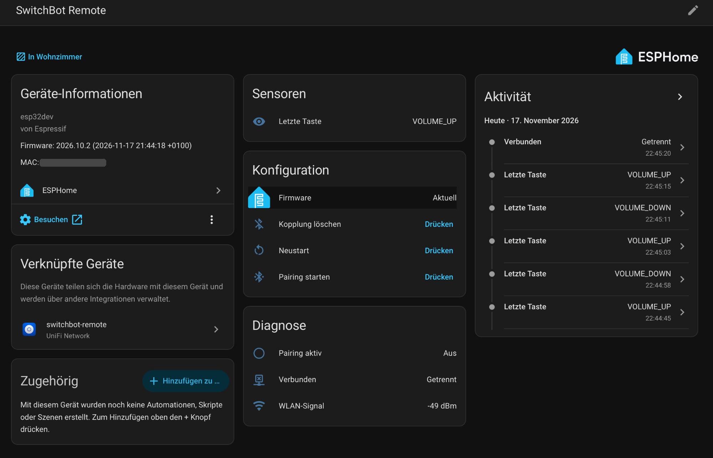

# SwitchBot Universal Remote → Home Assistant, without a hub

Use the keys of a **SwitchBot Universal Remote** to control anything in
**Home Assistant** – no SwitchBot hub, no cloud. An ESP32 running
[ESPHome](https://esphome.io) pairs with the remote like a TV box would and
forwards every key press to Home Assistant as an event.

```
SwitchBot remote ──Bluetooth Classic (HID)──▶ ESP32 (ESPHome) ──native API──▶ Home Assistant
                                                                              event: esphome.switchbot_remote
```

The remote talks to the ESP32 over **Bluetooth Classic**, which ESPHome's
built-in Bluetooth components (BLE only) cannot do. This repository therefore
contains a small ESPHome external component, `bt_classic_hid`: a Bluetooth
Classic HID host that searches for the remote, pairs with it, and decodes its
key reports. It should work with other Bluetooth Classic keyboards and remotes
too, but has only been tested with the SwitchBot Universal Remote.

> Not affiliated with or endorsed by SwitchBot, Espressif, ESPHome or Home Assistant.

## Demo

<p>
  
  &nbsp;
  
</p>

Left: the remote switches from the Apple TV to its Bluetooth Classic device
(named *SmartHome* here) and toggles a lamp through Home Assistant
([full-quality video](docs/demo.mp4)). Right: the ESP32 in Home Assistant with
the *Last key* sensor, the connection state and the pairing buttons (the
screenshot shows a German user interface).

## Requirements

- SwitchBot Universal Remote with the device type **“Bluetooth Classic (Beta)”**
  available in the SwitchBot app (under *third-party control*)
- An **original ESP32** board (e.g. ESP32-WROOM-32, `esp32dev`). The ESP32-S2,
  -S3, -C3, -C6 and -H2 have no Bluetooth Classic radio and will not work.
- ESPHome with the ESP-IDF framework, Home Assistant with the ESPHome integration

Tested in November 2026 with an ESP32-WROOM-32D, ESPHome 2026.10.2 (ESP-IDF 5.5.6)
and Home Assistant 2026.11.

## Setup

These steps assume Home Assistant with the **ESPHome Device Builder** add-on.
You do not need to clone this repository; the component is fetched from GitHub
during the build. (With the ESPHome command line the steps are the same, using
`esphome run switchbot-remote.yaml`.)

### 1. Create the device

1. In the Device Builder, open **Secrets** and make sure these four entries
   exist (see [`secrets.yaml.example`](secrets.yaml.example)):
   `wifi_ssid`, `wifi_password`, `ota_password` and `switchbot_remote_api_key`
   (32 random bytes, base64 – `openssl rand -base64 32`).
2. Create a new device and replace its whole configuration with the contents
   of [`switchbot-remote.yaml`](switchbot-remote.yaml).

### 2. Flash the ESP32

The first installation has to go over USB; all later updates work over the air.

1. In the Device Builder, build the device and download the firmware as
   **Factory Image**. The first build takes several minutes.
2. Connect the ESP32 to your computer, open <https://web.esphome.io> in Chrome
   or Edge, click **Connect**, pick the serial port, then **Install** and
   select the downloaded file.

(If your Home Assistant is reachable via HTTPS, the Device Builder can also
flash an ESP32 plugged into your computer directly from the browser.)

### 3. Pair the remote

1. In the SwitchBot app, add a device of type **Bluetooth Classic (Beta)** to
   the remote and put the remote into pairing mode.
2. While nothing is paired yet, the ESP32 searches for 10 minutes after boot
   for a device whose name starts with `SwitchBot` and pairs with it
   automatically (no PIN). If the window has passed, restart the ESP32 or
   press the **Start pairing** button of the device in Home Assistant.

The pairing survives restarts and firmware updates. After the remote has been
asleep it reconnects on its own when it wakes up; after an ESP32 restart the
ESP32 reconnects to the remote. **Remove pairing** forgets the stored key.

### 4. Add the device to Home Assistant

Under *Settings → Devices & services* the ESPHome integration shows the
discovered device *SwitchBot Remote*; add it. Besides the key events it
provides a *Connected* sensor, a *Last key* text sensor and the pairing buttons.

### 5. Use the keys

Select the Bluetooth Classic device on the remote, press a key and watch
*Last key* change. Then build automations on the events described below.

## Key events

Every key press arrives in Home Assistant as an `esphome.switchbot_remote` event:

| Field    | Example             | Meaning                                         |
|----------|---------------------|-------------------------------------------------|
| `key`    | `PLAY_PAUSE`        | name of the key, or its code if it has no name  |
| `code`   | `0C_00CD`           | HID usage page and usage id (hex)               |
| `action` | `press` / `release` | key went down or up                             |

Watch them under *Developer tools → Events → `esphome.switchbot_remote`*.

Keys of the remote in Bluetooth Classic mode:

| Key on the remote            | `key`          | `code`    |
|------------------------------|----------------|-----------|
| Rewind (screen key A)        | `REWIND`       | `0C_00B4` |
| Play/Pause (screen key B)    | `PLAY_PAUSE`   | `0C_00CD` |
| Fast forward (screen key C)  | `FAST_FORWARD` | `0C_00B3` |
| Menu (screen key D)          | `MENU`         | `0C_0040` |
| ON                           | `POWER`        | `0C_0030` |
| OFF                          | `SLEEP`        | `0C_0032` |
| Up / Down                    | `MENU_UP` / `MENU_DOWN`       | `0C_0042` / `0C_0043` |
| Left / Right                 | `MENU_LEFT` / `MENU_RIGHT`    | `0C_0044` / `0C_0045` |
| OK                           | `MENU_PICK`    | `0C_0041` |
| Back                         | `BACK`         | `0C_0224` |
| Home                         | `HOME`         | `0C_0223` |
| Volume + / −                 | `VOLUME_UP` / `VOLUME_DOWN`   | `0C_00E9` / `0C_00EA` |
| Mute                         | `MUTE`         | `0C_00E2` |

Holding a key down makes the remote repeat it (a press/release pair roughly
every 200 ms), which is handy for dimming.

A trigger for one key:

```yaml
triggers:
  - trigger: event
    event_type: esphome.switchbot_remote
    event_data:
      key: PLAY_PAUSE
      action: press
```

[`examples/home-assistant-automation.yaml`](examples/home-assistant-automation.yaml)
shows a single automation that handles several keys.

## The `bt_classic_hid` component

```yaml
bt_classic_hid:
  id: remote
  name: HA Bridge            # Bluetooth name of the ESP32 (default: esphome-hid-host)
  name_filter: SwitchBot     # pair only with devices whose name starts with this
  # mac_address: AA:BB:CC:DD:EE:FF   # ... or only with this address
  # auto_pairing: true       # search at boot while nothing is paired (default)
  on_key:                    # variables: key (string), code (string), pressed (bool)
    - logger.log:
        format: "%s %s"
        args: ['key.c_str()', 'pressed ? "down" : "up"']
  # on_connect: / on_disconnect:  actions when the remote connects / disconnects
```

If neither `name_filter` nor `mac_address` is set, the first device that
announces itself as a keyboard/remote is used.

Available from lambdas: `start_pairing(seconds)`, `stop_pairing()`,
`remove_bonds()`, `is_connected()`, `is_pairing()`.

How it works:

- brings up the Bluetooth controller in Classic-only mode and the Bluedroid
  HID host profile (it cannot be combined with `esp32_ble`, `esp32_ble_tracker`
  or `ble_client`);
- pairing uses Secure Simple Pairing in “Just Works” mode; the link key is
  stored in NVS by the Bluetooth stack;
- reads the remote's HID report descriptor and decodes input reports with a
  small generic parser ([`hid_report.h`](components/bt_classic_hid/hid_report.h)),
  so keys are reported by HID usage rather than by hard-coded byte patterns.
  Keyboard keys, consumer-control (media) keys and on/off bitmaps are
  supported; mouse movement is ignored.

## Limitations

- One remote per ESP32.
- The remote only sends keys while the paired Bluetooth Classic device is
  selected on the remote; it is one of the remote's devices, next to your TV
  or streaming box, not an overlay on top of them.
- Bluetooth Classic and WiFi share the ESP32's radio. This has been reliable
  in testing, but keep the ESP32 within a few metres of where the remote is used.
- “Just Works” pairing has no PIN: during the pairing window any device whose
  name matches the filter can pair. Use `mac_address` if that worries you.

## Background: why Bluetooth Classic?

Without a SwitchBot hub the remote can control SwitchBot BLE devices and act
as a Bluetooth remote for a few streaming boxes, but it cannot reach other
smart-home systems. The first idea was to let an ESP32 pose as such a box
using ESPHome's BLE client. That did not work: while the remote was in pairing
mode, an ESP32 BLE scanner saw no HID advertisement from it. The remote's
*Bluetooth Classic (Beta)* device type, however, makes it a standard Bluetooth
Classic HID keyboard that pairs with anything – a Mac, or an ESP32 running this
component.

## Development

Parser test on the host (no ESP32 needed):

```
g++ -std=c++17 -Wall -Wextra -fsanitize=address,undefined -Icomponents/bt_classic_hid tests/test_hid_report.cpp -o tests/test_hid_report
tests/test_hid_report
```

[`tools/builder.py`](tools/builder.py) drives the ESPHome Device Builder
add-on through Home Assistant, which is convenient when the ESP32 is managed
there: it uploads the YAML and the component, builds, installs over the air
and streams logs. It needs a Home Assistant long-lived access token in
`.secrets` (see [`.secrets.example`](.secrets.example)) and never uploads
secrets; the Device Builder's own `secrets.yaml` stays untouched.

```
python3 -m venv .venv && .venv/bin/pip install websockets esphome==2026.10.2
.venv/bin/python tools/builder.py push      # upload YAML + component
.venv/bin/python tools/builder.py install   # build in the Device Builder, flash over the air
.venv/bin/python tools/builder.py logs 60   # stream the device log for 60 s
.venv/bin/python tools/builder.py events 60 # watch the key events in Home Assistant
.venv/bin/python tools/builder.py status
```

The tool uploads the component from your checkout, so the configuration it
uses must load `bt_classic_hid` from the local path (see the commented block
in `switchbot-remote.yaml`). Personal settings can live in
`local/switchbot-remote.yaml` (git-ignored); the tool then uses that file
instead of the example configuration.

## License

[GPL-3.0-or-later](LICENSE). You may use, modify and redistribute this project;
if you distribute a modified version (as source or as firmware), you must make
its source available under the same license.
